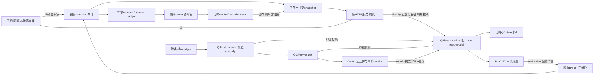

# 边界、ownership 与部署架构

## 路径及事实等级

R=本源码仓库；C=`R/orangepi/src/orangepi_collect/control`（下文C不是仓库根）；Q=既有QC运行源码（归档白名单见 `host/qc/SOURCE_MANIFEST.json`）。P1=阶段1私有审计报告（公开摘要见 `docs/system/phase3.md`）。R审计基线 `01bd5013112d31686c738e9aeadc55e3153c6d81` 是备份，不是生产批准。Q在phase1被确认非Git根，存在`.git`目录不能据此反转结论；Q/collector子树及非跟踪运行文件必须独立入BOM，不对Q执行reset。cp15与taskblock WIP保持隔离。

以下拓扑为**设计目标**，现状锚点见EVIDENCE，不把目标接口说成已运行。



## 模块责任/权威及故障隔离

|模块owner|唯一可写事实|读者/降级策略|
|---|---|---|
|设备controller|模式、controller_instance、接受的命令、session上下文、privacy判定|UI/host只读；失联=unknown而非stopped|
|硬件owner协调器+对应worker|owner_run、资源generation、开始/停止效果、测量与帧活性|controller仅按匹配的ACK提交，不能用PID存在代替证明|
|设备session ledger|session_id、封存manifest、任务reservations、终态attempt|host保留原始来源，不反写设备统计|
|Q receiver|收到哪些文件、hash/fsync、host custody receipt、QC job|fleet读其专用导出或 `mode=ro` 的受限metadata查询；禁止构造会建WAL/key/recover的Store|
|QC/normalizer/cloud worker|独立版本的QC结果、标准包hash、上传尝试及精确云receipt|重试是attempt，不重算新session；云live验证另带时点|
|Q fleet_monitor|可重建投影、抓取时间、来源冲突、事件revision|唯一writer；不是上面业务事实权威|
|R 40177 broker/jobs|维护计划、批准记录、执行作业及其结果|仍需维护权限；不得将“刷新”当snapshot GET|

### 一个主机read-model，多个来源账本

推荐沿用Q的 `fleet_monitor/history.py` 索引位置，迁移成投影表而非新聚合器：`device_observation(device_id, controller_instance, seq, payload, received_mono)`；`session_projection(device_id, session_id, source, source_revision, payload)`；`projection_cursor(source, revision)`。receiver.sqlite3仍由receiver独占业务写，history.sqlite3仅由fleet进程维护派生表。现有`History.upsert`“true不能变false、非空覆盖”规则不得用于v1：每个来源单独保存，用确定性projection选择展示，冲突显式reason，不吞掉QC更正/撤回。

40177通过loopback `/api/v1/fleet` 取同一payload（可反向代理纯读；不在浏览器跨域泄露凭据），不直接读另一份SQLite也不轮询设备。其jobs.cache只保留维护作业及其时点报告，字段标maintenance_observation，不能写回实时卡片。源DB不可用时保留旧投影+age/error，禁止回退扫描raw目录。旧缓存先双读比对，最后停用重复遥测writer；不删除历史证据。

host进程重启：从投影恢复只作stale历史，不复用上一进程monotonic计算fresh；新抓取后才fresh。SSE为可丢提示，携带host_instance/revision；缺序、重启或队列溢出通知reset，客户端重新GET全量。SSE订阅不得启动探测，HTTP流连接的注册只影响流分发，不影响设备display/privacy/demand。

## 硬件ownership：单一owner，状态与IO分离

`prepared → impedance → recording → stopping → released` 是同一owner_run下的模式；scan只允许released且无待决开始的资源generation。prepared可持有设备，但不得与scan或另一阻抗进程同时占有。授权转移必须有旧owner释放ACK+generation增加；未知owner仍持有，不得以超时/热插拔“假释放”。不同摄像头/EEG资源可以在同一owner_run被声明，禁止隐藏第二owner。

```text
唯一事件reducer：命令队列 / worker事件 / hotplug事件
  short reducer_lock → short ownership_lock → short snapshot_pointer_lock
  复制intent + generation；释放所有锁
  → 执行worker IPC / spawn / fsync / statvfs / 网络 / 日志入队
  → 带generation/instance的结果回事件队列，再短锁提交
禁止反向锁序；callback只投递有界事件；任意锁内禁止上述IO、join、等待另一个ACK。
```

不要靠持有Python RLock跨进程等外部资源。owner协调器串行管理资源状态；实现前枚举现有registry/privacy/UI/worker locks形成锁图，测试覆盖真实调用边而非只测新类。STOP有独立优先mailbox，合并同session重复请求，目标预算：接收/调度各≤250ms，效果证明≤3s、sealed≤30s（可配置并版本化；现场尚未保证）。3s无证据返回effect unknown、保留owner并告警，不能kill owner抢锁。STOP不等于文件封存；privacy显示恢复还需匹配stop proof。日志或媒体积压不得阻塞该mailbox。

热插拔使resource_generation递增、role proof/calibration失效；保留上次绑定为历史，禁止按端口名盲重绑并宣称confirmed。阻抗measurement绑定boot/controller/owner/session/profile_epoch。必须区分进行中样本新鲜度、监控快照陈旧与已完成测量证据有效性：进行中样本检查窗口/年龄；已完成且持久化的结果不得仅因用户等待确认而按固定30s等TTL失效。新测量、配置/连接generation、owner或controller变化按明确事件失效。review由设备权威gate判定有效读数、恢复、保存与身份；监控陈旧只标stale，不修改设备测量或发控制动作。无权威资格证据时can_review=null，明确拒绝时false，不能把unknown假写为已拒绝事实。

recovery_state（正常/重整/待维护）与data_filesystem_state（正常/缺卷/只读/IO错误/未知）正交。文件系统故障阻止新START和写数据，不阻止STOP及纯读状态；硬件故障不触发源数据删除。此图是约束，不是现有系统deadlock-free证明。

## 观测预算与安全cache

controller每1s及状态变更后发布不可变snapshot；资源采样独立低优先任务。RAM每5s读一次`/proc/meminfo`（≤64KiB），disk每30s最多对预登记的root/data两个挂载点statvfs一次；不得遍历raw、读取媒体stat或调用硬件probe。磁盘mount identity由已有storage owner缓存，取不到则unknown。阻塞statvfs不能靠Python线程timeout取消：最多一项在途，不再派生线程，age自然过期；不参与controller锁或STOP路径。worker测量以已有事件更新，无订阅就不新开设备。

GET仅复制已发布对象/预编码bytes；payload≤64KiB，host最多登记64机（超额分页，不扫描网段）；主机每设备2s一次、timeout≤1s、每设备最多一项在途、失败指数退避至60s。RAM stale_after=15s，disk=90s，snapshot=5s，host observation=10s。GET时用自身monotonic计算age允许，但不能renew lease/探测。独立模块safe cache只用固定私有路径、尺寸/owner/权限/symlink校验、atomic replace，每30s最多写一次；读缓存失败不创建文件。cache重启装载永不冒充当前运行状态。

## 部署BOM及网络边界

每个组件均记录 `component_id, source_revision, installed_manifest_hash, runtime_instance, runtime_loaded_manifest_hash, approval_id, observed_at`，四类证据独立nullable，未知不能用HEAD补。完整私有BOM受控保存，公开snapshot只放hash和状态，不带token、原配置、硬件serial。

|BOM组件|源/安装/运行必须独立核对|迁移owner|
|---|---|---|
|collector controller/worker/camd及236文件overlay|f5 base + overlay36d805；文件匹配≠内存已加载|设备release负责人|
|phone-link/ADB|现场研究v6，R源码v8.1；两者不同不自动升级|phone维护负责人|
|pi-phone-media / USB data-host / mount helper / udev / sudo|独立文件、unit、权限和实际加载状态|设备release负责人|
|tether observer / HTTP消费者 / NM feature profile|feature提交、窄selector、NM UUID、人工批准与启用状态|phone+网络负责人|
|Q collector子树 / receiver / QC / standardizer / uploader|逐组件基线，不以Q根是否Git推断来源|数据链负责人|
|Q service恢复dashboard|Documents固定import迁入可版本化包；fault-hold仍不启worker|QC负责人|
|fleet_monitor / recovery unit / 40177 broker|用户/系统unit分别清单，监听/权限、运行路径|host负责人|
|Family / Guest / 各设备NM配置|脱敏profile fingerprint，不公开连接secret|网络负责人|

Family仅头环→QC，Guest仅主机→云；无路由更改、以太网fallback、全网扫描。tether是手机→头环的第三条有线链，NM never-default/ignore-auto-dns/ignore-auto-routes且窄USB物理路径+driver、observer再核VID/PID；不得使用driver-wide selector，重叠直连子网仍需现场验证。

新snapshot复用原HTTP授权检查，不能因为“只读”绕过它；未来observer/operator/maintainer分scope。已知源码access_code_required默认false需阶段4显式迁移凭据，不能突然改变生产登录。host monitor源码bind与auth实效需核，0.0.0.0不等于已证漏洞，CORS也不是认证。推荐第一步在现受控边界验证host loopback代理+只读授权，再独立灰度设备鉴权。TLS推荐host管理入口先可信反代；手机USB-IP需可信证书/命名及发放维护方案后再启，不能一步全HTTPS、跳过证书验证或用不安全flags。普通HTTP USB-IP的Wake Lock限制在验收前保留为真实能力缺口。
